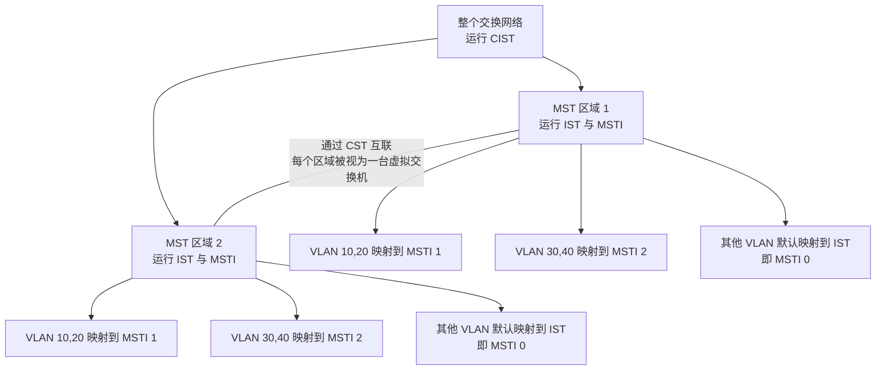

好的，我们以CCNP的标准来深入探讨MSTP。它诞生的核心原因，是为了解决传统生成树协议在面对大规模VLAN环境时的两大痛点：**低效的路径利用**和**巨大的资源消耗**。

### 为什么会有MSTP：从PVST+的困境说起

在MSTP（IEEE 802.1s标准）出现之前，Cisco网络主要使用PVST+（Per-VLAN Spanning Tree Plus）。

*   **PVST+的优势与代价**：PVST+为每一个VLAN都运行一棵独立的生成树，这让你可以为不同VLAN的流量选择不同的转发路径，实现**负载均衡**。但代价是，当网络中有数百甚至上千个VLAN时，交换机就需要运行同等数量的生成树实例，这会大量消耗CPU和内存资源，难以扩展。

*   **MSTP的解决思路**：MSTP则采用了一种折中方案。它将多个VLAN**映射**到同一个生成树**实例（Instance）** 中，而不是每个VLAN一个实例。这样一来，网络管理员只需维护少数几个实例（比如根据冗余链路的数量），就能实现负载均衡，同时极大地降低了设备的资源开销。

### MSTP是如何工作的：核心概念与运作机制

在CCNP的学习框架中，理解MSTP的关键在于以下几个层层递进的概念。

#### 1. MST区域 (MST Region)

这是MSTP的基石。一个MST区域可以被看作是一个逻辑上的管理边界，它由一组交换机组成，这些交换机必须同时满足以下三个条件：

1.  **相同的区域名称 (Region Name)**：一个不超过32字符的字符串，用于标识区域。
2.  **相同的修订号 (Revision Number)**：一个数值，用于标识配置的版本。
3.  **相同的VLAN与实例映射关系 (VLAN-to-Instance Mapping)**：这是最核心的配置，决定了哪些VLAN属于同一个实例。

只有当这些参数完全一致时，交换机之间才能交换MSTP的BPDU（桥接协议数据单元），并被视为在同一区域内协同工作。

#### 2. 生成树实例 (MSTI)

**实例就是vlan的集合**

*   **实例0 (IST)**：**内部生成树 (Internal Spanning Tree)**。这是每个MST区域内默认存在的、特殊的实例0。默认情况下，所有VLAN都映射到实例0。
*   **其他实例 (MSTI 1-4094)**：你可以根据需求创建并命名其他实例（如实例1、实例2），并将特定的VLAN映射到这些实例中。**关键点在于，同一个实例在不同区域是相互独立的**。例如，区域A的实例1和区域B的实例1，各自维护自己的生成树拓扑。
* 

**配置示例 (Cisco IOS)**：
```text
SW1(config)# spanning-tree mode mst                  ! 全局启用MST模式
SW1(config)# spanning-tree mst configuration         ! 进入MST配置模式
SW1(config-mst)# name CCNP_REGION                   ! 配置区域名称为CCNP_REGION
SW1(config-mst)# revision 1                          ! 配置修订号为1
SW1(config-mst)# instance 1 vlan 10, 20             ! 将VLAN 10和20映射到实例1
SW1(config-mst)# instance 2 vlan 30, 40             ! 将VLAN 30和40映射到实例2
SW1(config-mst)# end
```
**注意**：未映射到任何实例的VLAN（比如这里的VLAN 1-9, 50等）都会自动归属于实例0 (IST)。

#### 3. CIST, CST, 与区域边界

当你理解了区域和实例后，就可以从全局视角看MSTP的运作：

*   **CST (公共生成树)**：在MST区域**之间**，运行的是一个标准的、单一的生成树实例，用于连接各个MST区域以及可能存在的传统STP交换机。
*   **CIST (公共与内部生成树)**：它是**整个网络**的生成树视图，由所有区域的IST和区域间的CST共同构成。在MSTP BPDU中，CIST的信息是独立于各MSTI信息被承载和交换的。

一个MST区域对于外部的CST来说，就像是一台巨大的“虚拟交换机”。而**边界端口 (Boundary Port)**，就是位于区域边缘、连接其他区域或非MST交换机的端口。在边界端口上，交换机会根据对端设备类型，决定运行CST的STP/RSTP协议还是MSTP协议。

**以下是MSTP核心概念的关系图，可以帮助你更直观地理解：**



